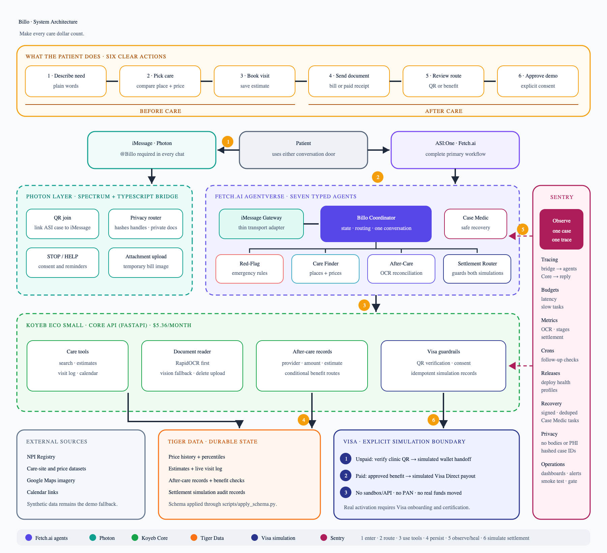

# Billo

[](https://github.com/kacytran1122/-billo/actions/workflows/ci.yml)



**Make every care dollar count.**

Billo is an AI care companion that helps patients understand costs before care and organize bills, receipts, benefits, and next steps afterward. It works in ASI:One and in tagged iMessage conversations through Photon Spectrum, with deterministic safety and payment rules around every AI-assisted action.

Built for **LA Hacks 2026** at UCLA.

> Every patient, provider, document, and payment shown in the demo is synthetic. Billo does not provide medical, legal, insurance, tax, or financial advice. In an emergency, call 911.

## Why Billo exists

Patients are often asked to make expensive healthcare decisions before they know the price, then decode unfamiliar bills and reimbursement rules after the visit. The useful information exists, but it is scattered across price files, provider records, receipts, benefit documents, and payment portals.

Billo keeps those steps connected. Before care, it screens for emergency signs, compares nearby options, records an estimate, and follows the visit. After care, it reads the final bill or paid receipt, matches it to the visit, explains what changed, and identifies possible benefit or reimbursement paths only when the patient names a real benefit.

## Tracks

| Track | How Billo fits |
| --- | --- |
| **Fetch.ai / ASI:One** | A coordinator routes each case through specialist agents for safety screening, care search, document organization, settlement checks, and recovery. |
| **Photon** | Billo joins iMessage through Spectrum and responds only when a user explicitly tags `@Billo`. |
| **TigerData** | Stores price history, visit events, document results, and after-care records for fast retrieval and comparison. |
| **Sentry** | Traces one case across the bridge, agents, OCR, API, and database, then wakes Case Medic when a monitored workflow fails. |
| **Visa** | Demonstrates guarded clinic-QR payment and reimbursement flows as simulations; no card data is collected and no money moves. |

## What it does

Before a visit, a patient can describe what happened in plain language. Billo applies fixed emergency rules first, then returns nearby care options and estimated prices, records the selected visit, and maintains a running expected total.

After the visit, the patient can upload a final bill or paid receipt. Local OCR reads the document first, a vision model assists only when confidence is low, and deterministic checks match the provider, line items, amount, and saved estimate. Billo then organizes follow-up documents and possible HSA, FSA, HRA, insurance, employer, school, travel, or accident-benefit paths.

An unpaid clinic bill can enter a simulated Visa QR flow only after the clinic, invoice, currency, and exact amount match. A paid receipt can enter a simulated reimbursement flow only after an external benefit approval. Both paths require explicit patient approval and are visibly labeled as simulations.

## Chat commands

```text
@Billo                                      show the command menu
@Billo my knee hurts near UCLA              screen safety and compare care
@Billo book 1                               save the selected visit and estimate
@Billo they did an X-ray                    update the live visit log
@Billo here is my final bill                read and organize an unpaid bill
@Billo here is my paid receipt              read and organize a paid receipt
@Billo I have an HSA                        check possible benefit paths
@Billo status                               show the current case and next action
STOP                                        cancel queued reminders
```

Billo stays quiet unless it is tagged, so ordinary conversation is never forwarded. Untagged `STOP` is the sole exception so opting out cannot be blocked.

## Architecture

The diagram follows a request from ASI:One or iMessage into the coordinator, through the specialist Fetch.ai agents, and into shared FastAPI tools for rules, OCR, storage, and drafting. TigerData holds durable case state, Sentry observes the workflow without receiving raw health data, and the Visa boundary remains a clearly labeled simulation.

```text
Patient
  ├─ ASI:One ───────────────┐
  └─ iMessage + Photon ─────┤
                            ▼
                    Billo Coordinator
                            │
          ┌─────────────────┼─────────────────┐
          ▼                 ▼                 ▼
   Safety + Care      After-Care OCR     Settlement Guard
          └─────────────────┼─────────────────┘
                            ▼
                  FastAPI + TigerData
                     │             │
                  Sentry      Visa simulation
```

## Why the AI cannot bypass the rules

The language model reads documents and phrases responses, but it does not decide whether an emergency flow stops, a bill matches, or a payment can continue. Those decisions live in deterministic code. A paid receipt cannot enter the clinic-payment branch, provider or amount mismatches block approval, repeated requests are idempotent, and silence never counts as consent.

Sentry receives a keyed case hash rather than a patient identity. Request bodies, query strings, model inputs and outputs, SQL parameters, uploaded documents, phone numbers, emails, dates, card-like numbers, and amounts are scrubbed before telemetry leaves the application.

## Repository

```text
backend/
  api/             FastAPI rules, OCR endpoints, care search, and case tools
  fetch.ai/        coordinator and specialist agents
  photon/          Photon Spectrum bridge for iMessage
  ocr/             local OCR and vision-fallback verification
  observability/   Sentry tracing, privacy filters, metrics, and recovery
  database/        TigerData schema
  integrations/    archived and simulated provider integrations
frontend/          responsive Next.js product experience
deploy/oracle/     Oracle Ampere deployment, Caddy, checks, and smoke tests
tests/              backend, frontend, Photon, OCR, and deployment tests
docs/               architecture and product documentation
.github/workflows/  CI and ARM64 container validation
```

## Run locally

Requirements: Python 3.11+, Node.js 22+, `uv`, Docker, and Make.

```bash
git clone https://github.com/kacytran1122/-billo.git
cd -- -billo
make setup
make env
```

Fill `.env` locally. Never commit API keys, agent seeds, database credentials, certificates, or private keys.

```bash
make test       # backend, OCR, safety, and integration tests
make core       # Core API at http://localhost:8000/docs
make fetch-ai   # Fetch.ai agents
make bridge     # Photon bridge
```

Run the frontend separately:

```bash
cd frontend
npm ci
npm run dev
```

Then open [http://localhost:3000](http://localhost:3000).

## Production

The frontend is designed for Vercel. The long-running FastAPI, OCR, Fetch.ai, and Photon services deploy as ARM64 containers on an Oracle Ampere A1 VM behind Caddy.

```bash
cd deploy/oracle
./install.sh
python3 smoke-test.py https://api.heybillo.tech
```

Keep `BILLO_MODE=demo` during the first deployment. After HTTPS, database, Sentry webhook, OCR, and end-to-end smoke checks pass, switch to `BILLO_MODE=live` and perform one final tagged iMessage test with a sanitized document.

## What is real and what is simulated

| Part | Status |
| --- | --- |
| Fetch.ai agents and Chat Protocol | Real |
| Emergency rules and after-care routing | Real deterministic code |
| OCR and vision fallback | Real; vision runs only when local OCR is uncertain |
| TigerData persistence | Real when `DATABASE_URL` is configured |
| Photon iMessage transport | Real when Spectrum credentials and a line are configured |
| Sentry tracing and recovery | Real after the signed webhook is configured |
| NPI registry lookup | Demo by default; live mode is available |
| Care prices | Synthetic until public price files are loaded |
| Visa payment and reimbursement | Deliberate simulation only |

## Safety notes

- Emergency indicators stop shopping and direct the patient to urgent help.
- Benefit results are possible paths, not eligibility decisions or guarantees.
- Uploaded documents are deleted after extraction.
- No PAN, CVV, or bank credential is collected.
- Every settlement result states that it is simulated.
- Every payment-like action requires explicit approval.

## License

MIT
