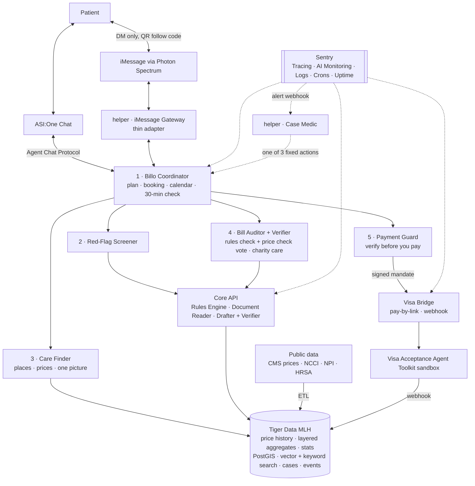
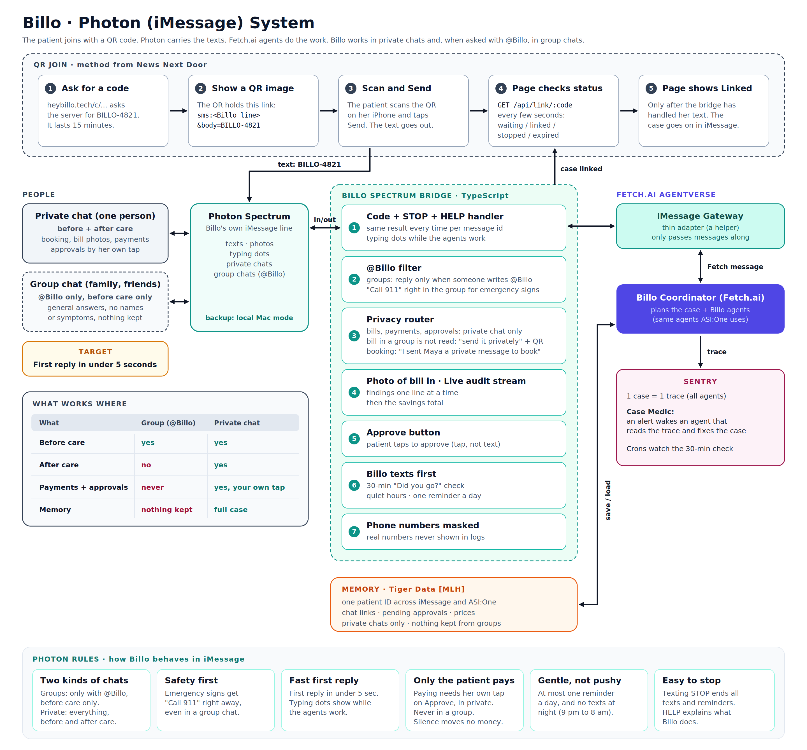
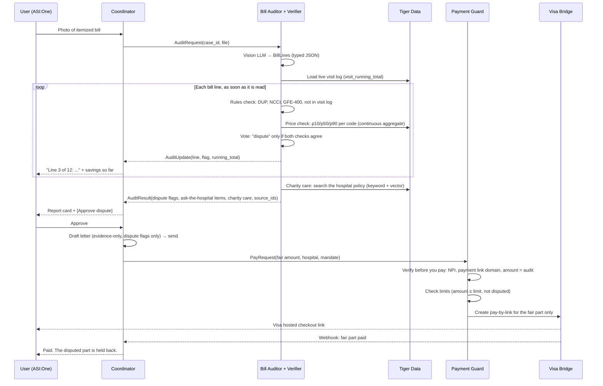
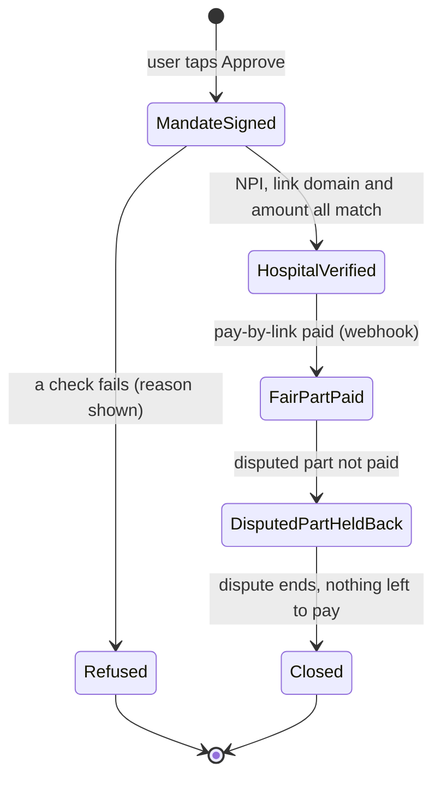

# Billo


**Care without the sticker shock.**

*Find the right care before you go. Pay only what is fair after you go.*

Billo is a group of AI agents on Fetch.ai that helps patients choose affordable medical care, check their hospital bills for mistakes, fight unfair charges, and pay safely with Visa.

**Just @Billo your bill.** The name is short on purpose: easy to say, easy to remember, and quick to type when you mention it in a chat.

**Website:** [heybillo.tech](https://heybillo.tech). The name matches how people talk to Billo: "Hey Billo, check my bill."

> Built for the **AI Hackathon by LA Hacks (UCLA), Oct 17–18, 2026**
> Tracks: **Fetch.ai ASI:One Agent Challenge (main)** · **Photon (Agents in iMessage)** · **Visa** · **Tiger Data [MLH]** · **Sentry**

See [COMPARISON.md](COMPARISON.md) for how we compared Billo with past winners.

> **Fetch.ai rule we follow:** the complete primary workflow (symptoms → places and prices → booking → bill audit → payment request) runs **entirely inside one ASI:One conversation, with no custom frontend**. iMessage (Photon) and the heybillo.tech page are extra doors to the same agents, never required. Try it: [ASI:One shared chat](#) · Agent profiles: see [Agent names and addresses](#agent-names-and-addresses).

---

## Table of Contents

1. [What is Billo? (Simple explanation)](#1-what-is-billo-simple-explanation)
2. [The Problem](#2-the-problem)
3. [What Billo Does](#3-what-billo-does)
4. [Demo Story](#4-demo-story)
5. [Technical Architecture](#5-technical-architecture)
6. [The Agents](#6-the-agents)
7. [Data Layer (Tiger Data [MLH])](#7-data-layer-tiger-data-mlh)
8. [Payments (Visa + Fetch Payment Protocol)](#8-payments-visa--fetch-payment-protocol)
9. [Observability (Sentry)](#9-observability-sentry)
10. [Trust, Safety & Privacy](#10-trust-safety--privacy)
11. [Tech Stack](#11-tech-stack)
12. [Data Sources](#12-data-sources)
13. [Project Structure](#13-project-structure)
14. [Getting Started](#14-getting-started)
- [Submission checklist (Fetch.ai)](#submission-checklist-fetchai)
15. [How We Meet Each Track](#15-how-we-meet-each-track)
16. [Limitations & Roadmap](#16-limitations--roadmap)
17. [Disclaimer](#17-disclaimer)

---

## 1. What is Billo? (Simple explanation)

Billo is an AI helper for people who need medical care and want to pay a fair price. First, when you get sick or hurt, you tell Billo what happened. It checks for danger signs, and if it is an emergency, it tells you to call 911 right away. If it is not an emergency, Billo shows you nearby places, like urgent care, the ER, or a low-cost clinic, and it tells you how much each one usually costs, so you can choose the best one for you. After you choose, Billo books the visit and gets a written price estimate from the clinic. Later, when the bill comes, you take a photo of it and send it to Billo. Then many small AI agents work together to read every line of the bill. They look for mistakes, such as the same test charged two times, and they compare the bill with the estimate and with the hospital's own public prices. If the bill has a mistake or is much higher than the estimate, Billo writes a letter to dispute it. If the price is only higher than other clinics nearby, Billo shows you the numbers so you can ask for a lower price. It also checks if you can get free or cheaper care because of your income. Finally, when the bill is fair, you can pay it safely with Visa, but only after you say yes. In short, Billo helps you find the right care before you go and makes sure you only pay what is fair after you go.

---

## 2. The Problem

- **People don't know prices before care.** The same X-ray can cost $60 at one place and $600 at another a few miles away.
- **Bills are hard to read and often wrong.** Duplicate charges, codes that should be billed together, and visit levels coded too high are common.
- **Patients don't use the rights they already have.**
  - Under the **No Surprises Act**, uninsured and self-pay patients get a **Good Faith Estimate**. If the bill is **$400 or more above** it, they can dispute within **120 days** (about a $25 fee).
  - In California, the **Hospital Fair Pricing Act (AB 1020)** requires hospitals to offer free or discounted care to patients at or below **400% of the federal poverty level**.
  - Nonprofit hospitals (IRS **section 501(r)**) cannot charge patients who qualify for financial assistance more than they usually charge insured patients.
- **The data now exists.** Since **April 1, 2026**, CMS requires hospitals to publish **actual prices** (median, 10th and 90th percentile amounts insurers paid). It is just too big and messy for a normal person to use.

Billo turns these rules and this data into actions a normal person can take in one conversation.

---

## 3. What Billo Does

### What the patient does (only 6 things)

Billo is built so the patient does as little as possible. First, you tell Billo what happened in your own words, for example "I twisted my ankle and I'm paying myself." Billo checks for danger signs and then shows you a few nearby places with their usual prices, so you only need to pick one. Next, you approve the visit and set your spending limit, which tells Billo how much it may pay, to which hospital, and until when. After the visit, when the bill arrives, you take a photo of it and send it in the same chat. Billo reads every line and shows you a short report, and if it finds mistakes or charges that are too high, you tap Approve and Billo writes and sends the dispute letter for you. Finally, when the bill is fair, you approve the payment and Visa pays only the fair amount. You never fill in long forms, read billing codes, or call the hospital yourself.

| # | You do | Billo does for you |
|---|---|---|
| 1 | **Say what happened** in plain words | Checks for emergency signs first (and says "Call 911" if needed) |
| 2 | **Pick a place** from a short list | Finds nearby care, shows the usual price of each with sources, and shows one picture of each place (from above or from the street) |
| 3 | **Approve the visit** and set your spending limit | Books the visit, gets a written price estimate, and adds it to your calendar |
| 4 | **Send a photo of the bill** when it arrives | Reads every line, checks for mistakes, compares with the estimate and area prices |
| 5 | **Approve the dispute** | Writes the dispute letter and the charity-care application, sends them, tracks the deadline |
| 6 | **Approve the payment** | Checks the hospital first, then pays only the fair amount with Visa and holds back anything still disputed |

**What the patient needs to have:** a phone with ASI:One or iMessage, the bill (paper or PDF), a payment card, and, only for charity care, a rough idea of household income and size. **What the patient never has to share:** their card number with the AI, their Social Security number, or anything the hospital doesn't need.

### Act 1: Before care (Where-To-Go)

|Step |What happens |
|---|---|
| Safety check |Fixed rules check for emergency signs. If found, the answer is **"Call 911 now."** No AI guessing. |
| Find care |Nearby urgent cares, ERs, community health centers, and telehealth options |
| Compare prices |Typical price at each place, with sources from hospital price files |
| See the place |One picture per place (a satellite view or a street view of the entrance), plus wheelchair access and parking |
| Book + estimate |Books (or calls ahead) and requests a **Good Faith Estimate** |
| No deposit |Billo does not take a deposit in the core version. There is never a deposit for ER visits. |

### Start at any step

Most people only think about Billo after a scary bill arrives, so the patient can start in two ways. They can **start before care**, by telling Billo what happened so it can find a place, show the price and book the visit. Or they can **start with just a bill**, by sending a photo of a bill they already have, even if they never used Billo before. In the second case Billo skips straight to checking the bill. It asks whether the clinic gave a written price estimate, writes a request for the **itemized bill** if the patient only has a total, explains how to report it if a self-pay patient should have received an estimate but didn't, and writes a **refund request letter** to the hospital if the patient already paid too much. If the hospital doesn't work with Billo, Billo tells the patient the exact fair amount and how to pay it on the hospital's own website. A clinic can also print Billo's QR follow code on its discharge sheet with the words "Text this to check your bill, or visit heybillo.tech", so a new patient can start in iMessage with just a bill.

### Calendar and visit follow-up

When the patient approves a visit, Billo **adds it to their calendar** so they don't forget. In iMessage, Billo sends a small calendar file (`.ics`) that opens straight in the **iPhone Calendar** with one tap, and it also sends an **"Add to Google Calendar"** link for people who use Google. The event has the clinic name, address, time, a link to the place pictures, and a reminder one hour before.

After that, the **Billo Coordinator** runs one small timed job every **30 minutes** to see which visits need a message, so Billo never forgets to ask. This is not a separate agent. It is one job inside the Coordinator, and Sentry Crons watches it:

| When | What Billo sends |
|---|---|
| Visit starts within the next 30 minutes | "Your visit at Westwood Urgent Care is at 3:00. Tap *I'm here* when you arrive." |
| Visit should be over, but no "I'm here" and no clinic check-in | "Did you go to your visit today?" (yes / no) |
| Still no reply the next day | One more gentle ask, then Billo stops asking |
| Patient says "no" | The visit is marked missed, and Billo offers to book a new time |
| Patient says "yes" | Billo waits for the bill and asks for a photo when it arrives |
| Patient texts STOP | All queued reminders for that patient are cancelled, and Billo sends nothing more |

**Silence never moves money:** if the patient never answers, nothing is charged.

```python
# Billo Coordinator (uAgents) — follow-up check runs every 30 minutes
from sentry_sdk.crons import monitor

@agent.on_interval(period=1800.0)             # 30 minutes, inside the Coordinator agent
@monitor(monitor_slug="visit-followup")       # Sentry Crons: alerts if a run is missed or fails
async def check_visits(ctx: Context):
    for v in await due_reminders():           # starts in the next 30 min, not reminded yet, patient did not text STOP
        await send(v.patient, f"Your visit at {v.clinic} is at {v.time}. Tap I'm here when you arrive.")
    for v in await due_followups():           # ended, no check-in, not asked yet (or asked > 24h ago, once)
        await send(v.patient, "Did you go to your visit today? (yes / no)")
```

```sql
CREATE TABLE visits (
  visit_id UUID PRIMARY KEY, case_id UUID, clinic_npi TEXT,
  starts_at TIMESTAMPTZ, ends_at TIMESTAMPTZ,
  status TEXT,              -- booked | checked_in | done | missed | canceled
  reminded_at TIMESTAMPTZ, asked_at TIMESTAMPTZ, asks INT DEFAULT 0
);
```

### Seeing the place before you go (Place View)

Going to a new clinic can be stressful, so Billo lets the patient see each place before choosing it. Every place card has **one picture**. Billo uses a **street picture** of the front entrance when Google has one, so the patient knows what to look for when they arrive. If there is no street picture, Billo uses a **satellite picture** that shows the building and the parking lot. Inside photos, such as the waiting room, are a stretch goal and are not part of the core version. Billo also says whether the entrance is **wheelchair accessible** and whether there is **parking**, so the patient can plan the trip.

| What the patient sees | Where it comes from (Google Maps Platform) |
|---|---|
| One picture per place: the front entrance from the street | Street View Static API (Billo checks the free metadata call first, so it never sends an empty picture) |
| If there is no street picture: the building and parking from above | Maps Static API (satellite map type) |
| Wheelchair entrance, parking | Places API (New) accessibility and parking options |
| A live map to explore (optional) | Link to the place on Google Maps |
| Stretch goal: inside photos (waiting room, front desk) | Places API (New) place photos |

**How it shows up in chat:** in iMessage, the picture arrives as a normal photo message under each option ("2 · Westwood Urgent Care · ~$180 · 0.8 mi"). In ASI:One, it appears inside the option card. The patient never has to leave the chat.

**Rules we follow:**
- Every picture shows Google's attribution.
- We **do not save** Google images in our database, because Google's terms limit caching. We fetch them fresh, and only store the place ID.
- If we add inside photos later, Billo will label them "from Google Maps", because visitors often upload them and they may not be current.
- Street View already blurs faces and license plates, and Billo never shares the patient's own location with anyone.

### Act 2: After care (BillBuster)

|Step |What happens |
|---|---|
| Read the bill |User sends a photo or PDF of the itemized bill |
| Live, line by line |Billo checks the bill **one line at a time** and sends each finding the moment it is found, with a running "possible savings" total (see [Real-time bill audit](#real-time-bill-audit)) |
| Check every line |Duplicates, codes that should be billed together, inflated visit levels, prices far above the hospital's own median |
| Compare |Bill vs. Good Faith Estimate, and bill vs. area prices |
| Two checks vote |A **rules check** and a **price check** look at every possible flag. Only flags that both checks agree on go into the dispute letter |
| Dispute or ask |**Dispute** when both checks agree. **Ask the hospital** when only one check finds a problem |
| Charity care |The Bill Auditor also checks income against the hospital's financial-assistance policy and fills in the application |
| Pay the fair amount |The Payment Guard checks the hospital, then pays the corrected amount with Visa pay-by-link, after the user approves |

### Two kinds of flags (honest by design)

The Bill Auditor works like a small vote, in the style of Quorum (a past Fetch.ai winner). Every possible flag is checked two times, in two different ways:

1. The **rules check** asks whether a fixed billing rule is broken. It looks for duplicate charges, NCCI codes that should not be billed together, and the $400 Good Faith Estimate rule.
2. The **price check** asks whether the money is really too high. It compares each line with **Tiger Data [MLH]** price percentiles (p10, p50, p90) for the same code in the same area.

A flag goes into the dispute letter **only when both checks agree**. When only one check finds a problem, Billo does not claim it is wrong. Instead, it becomes an **"ask the hospital"** item: a polite question or a request for a lower price.

|Flag |When |What Billo does |Example |
|---|---|---|---|
| **Dispute** |Both checks agree, and the user has a legal or contractual right |Puts it in the dispute letter |X-ray charged twice, and the two lines together cost about twice the area price for one X-ray |
| **Ask the hospital** |Only one check finds a problem |Asks a question or asks for a lower price, but does not dispute |"This splint is above 90% of LA hospitals", but no billing rule is broken |

Charity care is not a flag. It is a separate application that the Bill Auditor fills in when the patient's income fits the hospital's policy.

### Real-time bill audit

Billo audits in real time in two ways. The first way works while Billo reads the bill, and the second way works during the visit, before the bill even exists.

**1. Live audit stream (while Billo reads the bill).** Billo does not wait to finish the whole bill before it answers. The Document Reader turns the photo into lines, and the Bill Auditor checks **each line as soon as it is ready**. Every finding goes to the patient right away, in iMessage or ASI:One, and a running total shows how much money may be saved so far.

```
Billo:  Reading your bill... 12 lines found.
Billo:  Line 3 of 12: the X-ray is charged twice. Checking... (rules check: yes)
Billo:  Line 3 of 12: price check also says yes. This goes in the dispute letter.
Billo:  Line 7 of 12: the splint is above 90% of LA hospitals, but no rule is broken.
        This becomes an "ask the hospital" item.
Billo:  Possible savings so far: $1,960. Done. Tap Approve to send the dispute.
```

Each finding first shows as **"checking"**. It becomes a **dispute** only after both checks agree, so the live stream is faster but never less careful. The dispute letter and the payment still wait for the patient's tap.

**2. Live visit log (during the visit).** While the patient is at the clinic, they can text what happens, for example "They did an X-ray" or "They gave me a knee brace". The Coordinator saves each event with its time in Tiger Data and looks up the real local price. It then replies with a **running estimate**: "Your visit so far: about $310." When the real bill arrives, the Bill Auditor compares every line with the visit log at once, so a charge for something that never happened, or a total $400 or more over the Good Faith Estimate, is flagged in seconds.

```python
# Bill Auditor: stream findings line by line instead of one big report
async def audit_stream(ctx, case_id: str, lines: list[BillLine]):
    total_at_stake = 0.0
    for line in lines:                                   # lines arrive as the reader finishes them
        with sentry_sdk.start_span(op="audit.line", name=f"line {line.line_no}"):
            rules = rules_check(line, case_id)           # DUP, NCCI, GFE-400, not in visit log
            price = await price_check(line)              # Tiger Data p10/p50/p90
            flag  = vote(rules, price)                   # dispute only if both agree
            if flag:
                total_at_stake += flag.amount_at_stake
                await ctx.send(COORDINATOR, AuditUpdate(
                    case_id=case_id, line_no=line.line_no, flag=flag,
                    running_total=total_at_stake, done=False))
    await ctx.send(COORDINATOR, AuditUpdate(case_id=case_id, running_total=total_at_stake, done=True))
```

```sql
-- Tiger Data [MLH]: live visit log, one row per thing the patient says happened
CREATE TABLE visit_events (
  time TIMESTAMPTZ NOT NULL DEFAULT now(),
  case_id UUID NOT NULL, item TEXT, code TEXT,    -- "X-ray" -> 73560
  est_price NUMERIC, source_id TEXT
);
SELECT create_hypertable('visit_events', by_range('time'));

-- Running estimate per case, always up to date (real-time aggregate)
CREATE MATERIALIZED VIEW visit_running_total
WITH (timescaledb.continuous, timescaledb.materialized_only = false) AS
SELECT case_id, time_bucket('5 minutes', time) AS bucket,
       sum(est_price) AS est_total, count(*) AS items
FROM visit_events
GROUP BY case_id, bucket;
```

`materialized_only = false` makes the view **real-time**: it joins the saved summary with the newest rows, so the running estimate includes the X-ray the patient texted one second ago.

**Later (Roadmap): audit before the bill comes.** Insurers must share claims through the FHIR Patient Access API, and Medicare has the Blue Button 2.0 sandbox. Billo could check for new claims every few hours and audit a claim weeks before the paper bill arrives. This is not in the hackathon build.

---

## 4. Demo Story

**Maya** is a UCLA student. She hurt her knee playing soccer, and she pays for care herself. The demo video is **3 to 5 minutes** (the Fetch.ai rule) and has three parts.

**Part A · The full flow in ASI:One (Fetch.ai), about 2 minutes.** Everything in this part happens inside one ASI:One conversation, with no other app or web page.

1. Maya asks: "My knee hurts after soccer, I'm paying myself, near UCLA." The **Red-Flag Screener** checks for danger signs and clears it.
2. The **Care Finder** shows a carousel card with 3 places, each with a real price, a source and one picture. Maya picks urgent care, fills in the booking card, and Billo saves the Good Faith Estimate ($240) and sends the calendar file.
3. Later, Maya uploads a photo of her bill ($2,140) in the same chat. The **live audit** fills the review card **one line at a time**, and the savings total goes up. The Bill Auditor finds 3 possible flags, and the verifier **rejects the splint flag on screen**, because only the price check agrees. The other two flags go into the dispute letter, and Maya taps Approve.
4. The **Payment Guard** shows a payment review card: hospital verified, fair part to pay, disputed part held back. Maya approves, the **Agent Payment Protocol** sends the payment request, and Visa's sandbox confirms the fair part is paid.

**Part B · The same agents in iMessage (Photon), about 1.5 minutes.**

5. In a friends' group chat, Alex writes "@Billo where should Maya go for her knee?" Billo answers in general terms with the same 3 places and says booking happens in private.
6. Maya scans the QR code (shown inside ASI:One or on the discharge sheet), taps Send, and her private chat is linked. At the clinic she texts "They did an X-ray and gave me a splint," and Billo replies with a **live running estimate**. After the visit, Billo texts first: "Did you go to your visit today?"
7. Maya texts STOP, and all of her queued reminders are cancelled.

**Part C · Billo heals itself (Sentry), about 30 seconds.**

8. We break the NPI lookup live. **Case Medic** sees the Sentry alert, marks the check "unverified", continues the case, and Maya gets a calm message: "One check is slow. I am re-checking." We show the same trace in Sentry.

> All patients, bills and estimates in the demo are **synthetic**. Hospital prices come from **real public price files**.

---

## 5. Technical Architecture

### 5.1 System overview


A more detailed version (every table, payment step and Sentry signal) is in [`architecture-detailed.png`](architecture-detailed.png).

**Read it top to bottom:**

1. **Two front doors.** The patient chats in **ASI:One** or in **iMessage** (through Photon). Both doors reach the same agents, and the full flow works in each one.
2. **Agentverse (Fetch.ai).** Billo has **5 public agents** and **2 small helpers**. The **Billo Coordinator** plans the work and sends it to the **Red-Flag Screener** and **Care Finder** (before care), the **Bill Auditor + Verifier** (after care) and the **Payment Guard** (pay). The **iMessage Gateway** is a thin adapter for iMessage, and **Case Medic** fixes cases when Sentry sends an alert.
3. **Core API.** Shared services the agents use: the **Rules Engine** (decides), the **Document Reader** (reads bills), and the **Drafter + Verifier** (writes letters from evidence only).
4. **Data and payments.** **Tiger Data** stores every price-file version, self-updating summaries (hospital → region → county), statistics, map and policy search, cases and events. **Public data** flows into Tiger Data. **Visa** runs one simple, real payment flow: signed mandate, hospital check, a pay-by-link for the fair part, and a webhook that updates the case.
5. **Sentry** watches every layer, and its alerts wake **Case Medic**, which acts on them.

> The PNG diagrams above were drawn for an earlier plan. The mermaid diagram below shows the current structure.

Simple text version (renders on GitHub):



### Photon (iMessage) system



Billo lives in iMessage through its own small system. **Photon Spectrum** gives Billo its own iMessage line, and Spectrum delivers texts, bill photos, files and reactions in both directions. Billo works in **two kinds of chats**. In a **group chat**, Billo helps only with **before care** and replies only when someone writes **@Billo**. In a **private chat**, Billo helps with **everything**, before and after care. Choosing where to go is often a group decision with family or friends, but bills and payments are private, so they never appear in a group. Every message goes through the **Billo Spectrum Bridge**, a small TypeScript service with seven parts that make iMessage safe and fast before anything reaches the agents:

1. **Inbox listener** receives every text, bill photo and reaction from Spectrum, and marks each one as private or group.
2. **@Billo filter** ignores every group message that does not mention @Billo, so Billo never reads the rest of the group's conversation.
3. **Privacy router** decides what may be said where. In a group, Billo answers only before-care questions, in general terms, and never repeats anyone's symptoms or name. Booking, the visit log, bills, the audit, payments and approvals always move to the private chat.
4. **Identity + linking** matches the phone number to one patient. It links the chat to a case with the **QR follow code** (see below).
5. **Approval reader** counts a thumbs-up as "Approve" only when it comes from the patient's own number, and only in the private chat.
6. **Command handler** treats the follow code, STOP and HELP the same way every time. It is idempotent per message id, so a resent message never runs twice. STOP cancels all queued reminders for that patient.
7. **Outbox sender** shows **typing dots** right away and sends Billo's replies, place pictures, calendar files and Visa payment links back into iMessage. Our target is a **first reply in under 5 seconds**.

The bridge passes each message to the **iMessage Gateway**, a helper uAgent on Fetch.ai's Agentverse. It is a **thin adapter**, not a thinking agent: it only turns each iMessage into a normal Fetch message for the **Billo Coordinator** and sends the reply back. ASI:One never needs it. That means iMessage uses exactly the same agents, data and payments as ASI:One. **Tiger Data** remembers who is who (one patient ID across iMessage and ASI:One, chat links, last messages, pending approvals), so a case can start in iMessage and finish in ASI:One. **Sentry** traces every iMessage from the bridge through the gateway to the agents, watches the bridge's `/health` endpoint, and alerts the team if the iMessage line stops sending or receiving, without ever sending message text or health data to Sentry. If Photon's cloud line fails at the event, Spectrum's **local Mac mode** is the backup.

**What works where:**

| | Group chat (@Billo) | Private chat |
|---|---|---|
| When Billo replies | Only when someone writes @Billo | Every message |
| Before care | Yes: emergency warning, places nearby, prices, a picture of each place, hours | Yes, plus booking, the calendar file and the live visit log |
| After care | No | Yes: bill photo, live audit, dispute letter |
| Payments and approvals | Never | Yes, only by the patient's own tap |
| What Billo remembers | Nothing from the group | The full case, in Tiger Data |

**How the hand-off works:**

```
Group chat
Alex:   @Billo where should Maya go for her knee? It hurts when she walks.
Billo:  Here are 3 places near UCLA for a knee injury, with real prices:
        1. Westwood Urgent Care · about $240 · open until 9 pm  [picture]
        2. Campus Clinic · about $180 · open until 6 pm          [picture]
        3. Santa Monica ER · about $1,800 · open 24 hours        [picture]
        Maya, I sent you a private message so you can book.

Private chat (Maya)
Billo:  Hi Maya, do you want to book Westwood Urgent Care for today at 4 pm?
```

If someone sends a bill photo in a group, Billo does not read it. It replies: "Bills are private. Please send it to me in a private chat." If that person has not joined Billo yet, Billo adds the QR link. Safety still comes first: if a group message mentions emergency signs, Billo says **"Call 911"** right in the group.

**Photon rules (how Billo behaves in iMessage):**

| Rule | What it means |
|---|---|
| Two kinds of chats | In groups, Billo replies only to @Billo and only for before care. In private chats, it helps with everything |
| Private things stay private | Bills, payments, approvals and the visit log never appear in a group, and Billo keeps nothing from group chats |
| Safety first | Emergency signs get "Call 911" right away, even in a group |
| Billo texts first | After the QR link, Billo sends the first hello, and 30 minutes after a visit it asks "Did you go?" |
| Fast and alive | Typing dots show at once, and the first reply comes in under 5 seconds |
| Only the patient approves | A thumbs-up counts only from the patient's own number |
| Gentle, not pushy | At most one reminder a day, and no messages during quiet hours (9 pm to 8 am) |
| Easy to stop | Texting STOP cancels all queued reminders and ends all messages, "delete my data" wipes the data, and silence never moves money |

### QR follow code (the method from News Next Door)

The patient joins Billo in iMessage by scanning a QR code. We use the method from News Next Door, a past Photon winner. There is no 6-digit code to type.

1. Billo makes the follow code when the patient asks to continue in iMessage. The QR image is sent **right inside ASI:One** as a card, so no web page is needed. The optional case page `heybillo.tech/c/BILLO-4821` (for discharge sheets) asks the server for a follow code, such as `BILLO-4821`. The code lasts **15 minutes** and is tied to one case.
2. The server builds a link `sms:<Billo line>&body=BILLO-4821` and turns it into a QR image with the `qrcode` npm package.
3. The page shows the QR code and an "Open in iMessage" button. Every few seconds it checks `GET /api/link/:code`, which answers `waiting`, `linked`, `stopped` or `expired`.
4. Maya scans the QR code and taps Send. The bridge sees the code and links this iMessage chat to her case. The page flips to "Linked" only after the server has processed her text.
5. The inbound handler treats the code, STOP and HELP the same way every time (idempotent per message id), so a resent code does not send a second hello.
6. The same code can be printed on a discharge sheet with the words "Text this to check your bill, or visit heybillo.tech". This lets a patient who never used Billo before start with just a bill.

### 5.2 Design principles

1. **The AI reads and writes. Code decides.**
   The LLM only does two things: it turns messy input (bill photos, free text) into **typed JSON**, and it writes plain-language text. Every decision (emergency or not, error or not, dispute or not, pay or not) is made by **fixed rules in code**, and each rule has a citation.

2. **Every claim has a source.**
   Each flag carries a `source_id` (price-file row, NCCI edit, Good Faith Estimate line, policy section). A verifier step removes any sentence the drafter writes that is not linked to evidence.

3. **The human approves every action.**
   Booking, sending a letter, and paying all need an explicit **Approve** from the user. The Payment Guard refuses anything outside the user's limits.

4. **Every tool can fail safely.**
   Each tool call has a timeout, a retry, and a fallback (cached data with an "unverified" label). Failures are visible in Sentry.

### 5.3 Request lifecycle: bill audit



### 5.4 Agent message contracts

All agents talk with **typed Pydantic models** (uAgents `Model`). Bad data is rejected before it reaches any agent.

```python
from uagents import Model
from typing import List, Optional, Literal

class BillLine(Model):
    line_no: int
    code: str                 # CPT / HCPCS / revenue code
    description: str
    units: int
    charge: float
    service_date: str

class Flag(Model):
    rule_id: str              # e.g. "DUP-001", "NCCI-PTP", "GFE-400", "PRICE-P90"
    kind: Literal["dispute", "ask_hospital", "info"]
    rules_check: bool         # did a fixed billing rule find a problem?
    price_check: bool         # do Tiger Data percentiles confirm the money is too high?
                              # kind == "dispute" only when both are True
    line_nos: List[int]
    amount_at_stake: float
    explanation: str
    source_ids: List[str]     # evidence links (price row, NCCI edit, GFE line, policy §)

class AuditRequest(Model):
    case_id: str
    file_url: str
    hospital_npi: Optional[str] = None

class AuditUpdate(Model):      # streamed live, one per finding
    case_id: str
    line_no: Optional[int] = None
    flag: Optional[Flag] = None
    running_total: float      # possible savings so far
    done: bool

class AuditResult(Model):
    case_id: str
    lines: List[BillLine]
    flags: List[Flag]
    total_billed: float
    total_at_stake: float
```

### 5.5 Rules engine

Rules live in YAML, so they are easy to read, test and cite.

```yaml
# rules/bill_audit.yaml
- id: DUP-001
  kind: dispute
  when: same code AND same service_date AND units_total > expected_units
  explain: "This service was charged more than once on the same day."
  source: "Itemized bill lines"

- id: GFE-400
  kind: dispute
  when: billed_total - gfe_total >= 400   # per provider/facility
  explain: "Your bill is $400+ above your Good Faith Estimate. You can dispute within 120 days."
  source: "No Surprises Act, patient-provider dispute resolution (CMS)"

- id: PRICE-P90
  kind: ask_hospital    # price check only; it becomes a dispute only if a rule also agrees
  when: line.charge > area_p90(code, region)
  explain: "This price is higher than 90% of hospitals in your area."
  source: "Hospital price transparency files (Tiger Data aggregate)"
```

```yaml
# rules/red_flags.yaml (Where-To-Go safety check; runs FIRST, every time)
- id: RF-CHEST
  match_any: ["chest pain", "chest pressure", "pain spreading to arm or jaw"]
  action: CALL_911
- id: RF-STROKE
  match_any: ["face drooping", "arm weakness", "slurred speech"]
  action: CALL_911
- id: RF-BREATH
  match_any: ["can't breathe", "severe shortness of breath"]
  action: CALL_911
```

---

## 6. The Agents

All agents are **uAgents** registered on **Agentverse**. The Coordinator uses the **Agent Chat Protocol** so it can be found and used directly in **ASI:One**.

Billo has **5 public agents** on Agentverse and **2 small helpers**. We keep the number small on purpose, so each agent clearly does real work and the system stays easy to build and test during the hackathon.

|# |Agent |Job |Tools / data |Can be used alone? |
|---|---|---|---|---|
| 1 |**Billo Coordinator** |The front door for ASI:One. It understands the user, plans the case, sends work to the other agents and asks for approvals. It also books the visit, requests the Good Faith Estimate, sends the calendar file, and runs the 30-minute "Did you go?" check |Chat Protocol, Payment Protocol, estimates table, `.ics` file, Google Calendar link, `on_interval` (30 min), Sentry Crons |Yes (main entry) |
| 2 |**Red-Flag Screener** |Runs the safety rules first. If it might be an emergency, it says "Go to the ER now" (or "Call 911") and stops |`red_flags.yaml` |Yes |
| 3 |**Care Finder** |Finds nearby care, shows real prices for each place, and sends one picture per place plus wheelchair access and parking |NPI Registry, HRSA, Tiger Data price summaries, Google Maps Platform |Yes |
| 4 |**Bill Auditor + Verifier** |Reads the bill. Two checks vote on each flag (a rules check and a price check), and only flags that both agree on go into the dispute letter. It also checks charity-care eligibility and the $400 Good Faith Estimate rule, and it tracks the 120-day dispute deadline |Vision LLM, NCCI edits, Tiger Data percentiles, pgvector policy search, AB 1020, 501(r), rules engine |Yes |
| 5 |**Payment Guard** |Works inside the user's signed limits. It verifies the hospital before paying, pays only the fair part, and never pays a disputed amount. It never takes a deposit for an ER visit |Fixed code + Visa Bridge |— |
| helper |**iMessage Gateway** |A thin adapter between the Photon bridge and the Coordinator. It does not think or plan |Photon Spectrum bridge |— |
| helper |**Case Medic** |Wakes on a Sentry alert, reads the trace, and picks one of three fixed actions (see [9.6](#96-case-medic-sentry-inside-the-loop)) |Sentry alert webhook, Sentry API |— |

**What was merged:** The Care Finder includes the old Price Agent and Place View Agent. The old Visit Agent's booking, calendar and 30-minute follow-up are now one timed job inside the Coordinator. The old Charity-Care Agent is now part of the Bill Auditor, which also includes the estimate check.

### Agent names and addresses

Every public agent is registered on **Agentverse**, categorized under **Innovation Lab**, uses the **Agent Chat Protocol** with `publish_manifest=True`, and connects through an Agentverse **mailbox**. We fill in the real addresses and profile links during the hackathon.

| Agent | Address | Agentverse profile |
|---|---|---|
| Billo Coordinator | `agent1q...` (fill in) | `https://agentverse.ai/agents/details/agent1q.../profile` |
| Red-Flag Screener | `agent1q...` | link |
| Care Finder | `agent1q...` | link |
| Bill Auditor + Verifier | `agent1q...` | link |
| Payment Guard | `agent1q...` | link |
| iMessage Gateway (helper) | `agent1q...` | link |
| Case Medic (helper) | `agent1q...` | link |

### Interactive Cards in ASI:One

Billo uses **ASI1 Interactive Cards** so the patient taps instead of typing:

| Step | Card |
|---|---|
| Places and prices | A **carousel** of 3 places: price, source, one picture, hours |
| Booking | A **form**: time, spending limit, add to calendar |
| Live audit | A **review screen** that fills in line by line, with the savings total |
| Dispute | A **detail view** of each flag with its evidence, plus Approve |
| Payment | A **review screen**: hospital verified, fair part to pay, disputed part held back, Approve |
| Join iMessage (optional) | A card with the QR image and the `sms:` link, so no web page is needed |

"Can be used alone" means other ASI:One users or agents can call that agent directly. For example, anyone can ask the Care Finder "How much is an ankle X-ray near Westwood?"

### Coordinator skeleton

```python
from uagents import Agent, Context, Protocol
from uagents_core.contrib.protocols.chat import (
    ChatAcknowledgement, ChatMessage, TextContent, chat_protocol_spec,
)
import sentry_sdk

agent = Agent(
    name="billo-coordinator",
    seed=SEED,
    port=8001,
    mailbox=True,                 # connects to Agentverse / ASI:One
    publish_agent_details=True,
)
chat = Protocol(spec=chat_protocol_spec)

@chat.on_message(ChatMessage)
async def on_chat(ctx: Context, sender: str, msg: ChatMessage):
    await ctx.send(sender, ChatAcknowledgement(acknowledged_msg_id=msg.msg_id))
    with sentry_sdk.start_transaction(op="billo.turn", name="coordinator"):
        plan = await planner.plan(msg)          # LLM → typed Plan
        for step in plan.steps:                 # each step = one agent call
            result = await run_step(ctx, step)  # timeout + retry + fallback
            await store_event(step, result)     # Tiger Data hypertable
        reply = await renderer.render(plan)     # cards / text with sources
    await ctx.send(sender, ChatMessage(content=[TextContent(text=reply)]))

agent.include(chat, publish_manifest=True)
```

---

## 7. Data Layer (Tiger Data [MLH])

Billo keeps **everything in one Postgres database on Tiger Cloud**: millions of price rows, their full history, self-updating summaries, statistics, map search, vector search, case records and events. There is no second database and no separate search engine.

### 7.1 Features we use

| Area | Tiger Data feature | What it does in Billo |
|---|---|---|
| **Store** | **Hypertables** | `hospital_prices` keeps every price-file version; `billo_events` keeps every case step |
| | **Columnstore (compression)** | Old price rows are stored by column: 90%+ smaller and faster to scan |
| | **Price history** | Compare file versions to catch price jumps ("up 22% since April") |
| **Summaries** | **Hierarchical continuous aggregates** | Hospital (daily) → region (monthly) → county (quarterly); each level refreshes itself |
| | **Hyperfunctions** | `percentile_agg` (p10/p50/p90), `stats_agg` (average, std. deviation → z-score), `candlestick_agg` (open/high/low/close price per period) |
| | **Real-time aggregates** | Summaries include the newest rows that have not been rolled up yet |
| **Search** | **PostGIS** | "Clinics within 5 miles, open now, under $100 for this code", in one query |
| | **pgvector + pgvectorscale** | Fast vector search (StreamingDiskANN index) over hospital policies |
| | **Keyword search** | Postgres full-text search mixed with vector search, so "400% poverty level" finds the exact rule |
| | **pgai Vectorizer** | Creates and refreshes policy embeddings automatically when the text changes |
| **Cases & safety** | **Relational tables** | Cases, bills, flags, estimates, mandates, payments, chat links |
| | **Event hypertable + aggregates** | Case timeline for the user; live metrics for the team (savings, dispute wins, time to resolve) |
| | **Row-level security** | A user's queries only ever return that user's rows |
| | **Retention policies** | Raw events are deleted after 90 days; their summaries are kept |

### 7.2 Schema

```sql
-- ============ STORE ============
CREATE TABLE hospital_prices (
  posted_at        TIMESTAMPTZ NOT NULL,  -- version date of the price file
  hospital_npi     TEXT        NOT NULL,
  region           TEXT        NOT NULL,  -- e.g. 'LA-Westside'
  county           TEXT        NOT NULL,
  code             TEXT        NOT NULL,  -- CPT / HCPCS
  payer            TEXT,
  gross_charge     NUMERIC,
  discounted_cash  NUMERIC,
  allowed_median   NUMERIC,
  allowed_p10      NUMERIC,
  allowed_p90      NUMERIC
);
SELECT create_hypertable('hospital_prices', by_range('posted_at'));

-- Columnstore (TimescaleDB 2.18+; older versions: timescaledb.compress + add_compression_policy)
ALTER TABLE hospital_prices SET (
  timescaledb.enable_columnstore = true,
  timescaledb.segmentby = 'hospital_npi, code',
  timescaledb.orderby   = 'posted_at DESC'
);
CALL add_columnstore_policy('hospital_prices', after => INTERVAL '30 days');

-- ============ SUMMARIES (hierarchical continuous aggregates) ============
-- Level 1: per hospital, per code, per day
CREATE MATERIALIZED VIEW hospital_price_daily
WITH (timescaledb.continuous) AS
SELECT time_bucket('1 day', posted_at)                  AS bucket,
       hospital_npi, region, county, code,
       percentile_agg(allowed_median)                   AS pct,
       stats_agg(allowed_median)                        AS stats,
       candlestick_agg(posted_at, allowed_median, 1)    AS candle
FROM hospital_prices
GROUP BY bucket, hospital_npi, region, county, code;

-- Level 2: per region, per code, per month (built ON TOP of level 1)
CREATE MATERIALIZED VIEW region_price_monthly
WITH (timescaledb.continuous) AS
SELECT time_bucket('1 month', bucket) AS bucket, region, county, code,
       rollup(pct)    AS pct,
       rollup(stats)  AS stats,
       rollup(candle) AS candle
FROM hospital_price_daily
GROUP BY 1, region, county, code;

-- Level 3: per county, per quarter (built ON TOP of level 2)
CREATE MATERIALIZED VIEW county_price_quarterly
WITH (timescaledb.continuous) AS
SELECT time_bucket('3 months', bucket) AS bucket, county, code,
       rollup(pct) AS pct, rollup(stats) AS stats
FROM region_price_monthly
GROUP BY 1, county, code;
-- Statewide numbers = rollup() over county_price_quarterly at query time.

SELECT add_continuous_aggregate_policy('hospital_price_daily',
  start_offset => INTERVAL '3 months', end_offset => INTERVAL '1 hour',
  schedule_interval => INTERVAL '30 minutes');
-- (same pattern for the other two levels)

-- ============ SEARCH ============
CREATE EXTENSION IF NOT EXISTS postgis;
CREATE TABLE care_sites (
  site_id TEXT PRIMARY KEY, npi TEXT, name TEXT, kind TEXT,  -- urgent_care | er | fqhc | clinic
  sliding_scale BOOLEAN, hours JSONB, location GEOGRAPHY(POINT, 4326)
);
CREATE INDEX ON care_sites USING gist (location);

CREATE EXTENSION IF NOT EXISTS vectorscale CASCADE;   -- also installs pgvector
CREATE TABLE policy_chunks (
  hospital_npi TEXT, section TEXT, content TEXT,
  content_tsv  TSVECTOR GENERATED ALWAYS AS (to_tsvector('english', content)) STORED,
  embedding    VECTOR(768)
);
CREATE INDEX ON policy_chunks USING diskann (embedding vector_cosine_ops);
CREATE INDEX ON policy_chunks USING gin (content_tsv);
-- pgai Vectorizer (optional): keeps `embedding` up to date when policy text changes.
-- Configure with ai.create_vectorizer(...); check the current pgai docs for exact syntax.

-- ============ CASES & SAFETY ============
CREATE TABLE cases      (case_id UUID PRIMARY KEY, user_id UUID NOT NULL,
                         created_at TIMESTAMPTZ DEFAULT now());
CREATE TABLE estimates  (case_id UUID, provider_npi TEXT, code TEXT, amount NUMERIC, source_doc TEXT);
CREATE TABLE bill_lines (case_id UUID, line_no INT, code TEXT, description TEXT,
                         units INT, charge NUMERIC, service_date DATE);
CREATE TABLE flags      (case_id UUID, rule_id TEXT, kind TEXT, line_nos INT[],
                         amount_at_stake NUMERIC, source_ids TEXT[]);
CREATE TABLE mandates   (mandate_id UUID PRIMARY KEY, case_id UUID, max_amount NUMERIC,
                         merchant_npi TEXT, expires_at TIMESTAMPTZ, signature TEXT,
                         approved_at TIMESTAMPTZ);
CREATE TABLE payments   (payment_id UUID PRIMARY KEY, case_id UUID, mandate_id UUID,
                         kind TEXT,          -- fair_part (core); hold | refund | plan_installment are stretch only
                         amount NUMERIC, status TEXT, visa_ref TEXT,
                         idempotency_key TEXT UNIQUE, created_at TIMESTAMPTZ DEFAULT now());

-- Row-level security: each user only sees their own cases
ALTER TABLE cases ENABLE ROW LEVEL SECURITY;
CREATE POLICY own_cases ON cases
  USING (user_id = current_setting('app.user_id')::uuid);
-- (same policy pattern on bill_lines, flags, mandates, payments via case_id)

CREATE TABLE billo_events (
  time TIMESTAMPTZ NOT NULL DEFAULT now(),
  case_id UUID, agent TEXT, event_type TEXT,   -- tool_call | flag | vote | approval | payment | case_medic ...
  latency_ms INT, amount NUMERIC, payload JSONB
);
SELECT create_hypertable('billo_events', by_range('time'));
SELECT add_retention_policy('billo_events', INTERVAL '90 days');

-- Live team metrics (kept after raw events expire)
CREATE MATERIALIZED VIEW case_metrics_daily
WITH (timescaledb.continuous) AS
SELECT time_bucket('1 day', time) AS day,
       count(*) FILTER (WHERE event_type = 'dispute_sent')  AS disputes_sent,
       count(*) FILTER (WHERE event_type = 'dispute_won')   AS disputes_won,
       sum(amount) FILTER (WHERE event_type = 'saving')     AS dollars_saved,
       percentile_agg(latency_ms)                           AS latency
FROM billo_events
GROUP BY day;
```

### 7.3 Key queries

**1. Check every bill line (the heart of the Bill Auditor)**

```sql
SELECT b.line_no, b.code, b.charge,
       average(r.stats)                                     AS area_avg,
       (b.charge - average(r.stats)) / NULLIF(stddev(r.stats), 0) AS z_score,
       approx_percentile(0.50, r.pct)                       AS area_p50,
       approx_percentile(0.90, r.pct)                       AS area_p90,
       open(r.candle)  AS price_6mo_ago,
       close(r.candle) AS price_now
FROM bill_lines b
JOIN LATERAL (
  SELECT rollup(pct) AS pct, rollup(stats) AS stats, rollup(candle) AS candle
  FROM region_price_monthly
  WHERE code = b.code AND region = $2 AND bucket > now() - INTERVAL '6 months'
) r ON true
WHERE b.case_id = $1;
```

A `z_score` above 3 means "very unusual for this area", which feeds the **price check** in the Bill Auditor's vote with real statistics behind it.

**2. Price-jump alerts between file versions**

```sql
SELECT hospital_npi, code, bucket, median_now, median_before,
       round(100 * (median_now - median_before) / median_before, 1) AS pct_change
FROM (
  SELECT hospital_npi, code, bucket,
         approx_percentile(0.5, pct)                        AS median_now,
         lag(approx_percentile(0.5, pct)) OVER w            AS median_before
  FROM hospital_price_daily
  WINDOW w AS (PARTITION BY hospital_npi, code ORDER BY bucket)
) t
WHERE median_before > 0
  AND (median_now - median_before) / median_before > 0.15;   -- jumps over 15%
```

**3. Where-To-Go: nearby, open, affordable, in one query**

```sql
SELECT s.name, s.kind, s.sliding_scale,
       ST_Distance(s.location, ST_MakePoint($lon, $lat)::geography) / 1609 AS miles,
       approx_percentile(0.5, h.pct) AS typical_price
FROM care_sites s
JOIN LATERAL (
  SELECT rollup(pct) AS pct FROM hospital_price_daily
  WHERE hospital_npi = s.npi AND code = $code AND bucket > now() - INTERVAL '6 months'
) h ON true
WHERE ST_DWithin(s.location, ST_MakePoint($lon, $lat)::geography, 8047)   -- 5 miles
ORDER BY typical_price, miles
LIMIT 5;
```

**4. Charity-care policy search (keyword + vector)**

```sql
SELECT section, content,
       0.5 * ts_rank(content_tsv, plainto_tsquery('english', $q))
     + 0.5 * (1 - (embedding <=> $query_embedding))            AS score
FROM policy_chunks
WHERE hospital_npi = $npi
ORDER BY score DESC
LIMIT 5;
```

### 7.4 Price data pipeline (ETL)

```
CMS price file (JSON/CSV, often GBs; every published version)
   → stream parser (ijson / csv, chunked)          # never load the whole file in memory
   → normalize (code, payer, amounts, NPI, region, county)
   → COPY into hospital_prices (batches of 50k)
   → columnstore policy compresses old chunks
   → continuous aggregates refresh: daily → monthly → quarterly
```

Scope for the hackathon: **15–20 LA hospitals** and the **~70 CMS "shoppable services"** (X-rays, lab tests, urgent visits, etc.).

### 7.5 Performance targets (we will show measured numbers in the demo)

| Metric | Target |
|---|---|
| Price rows stored | 10M–40M |
| Storage saved by columnstore | ≥ 90% |
| Bill-line check on raw table | seconds |
| Bill-line check on hierarchical aggregates | < 50 ms |
| Where-To-Go map + price query | < 100 ms |
| Policy search (keyword + vector) | < 100 ms |

We will show `EXPLAIN ANALYZE` before and after each optimization, and the Sentry trace for the same query.

---

## 8. Payments (Visa + Fetch Payment Protocol)

**In plain words, step by step:**

① You sign your limits first: how much Billo may pay, to which hospital, for which case, and until when.

② Before any money moves, the Payment Guard verifies the hospital. It checks the hospital's NPI number, checks that the payment link goes to the hospital's real domain, and checks that the amount matches the bill audit.

③ Billo pays only the fair part of the bill. You pay on Visa's own page, so Billo never sees your card number.

④ Billo holds back the part that is still disputed, and it never pays that part until the dispute ends.

⑤ Visa sends a webhook when the payment goes through, the case page updates, and the case is closed when nothing is left to pay.

There is never a deposit for ER visits. In the core version, Billo takes no deposit at all.

The core payment is simple and real: **pay a bill fairly**. The deposit hold, the 0% monthly plan and refunds are stretch goals (see [8.7](#87-stretch-goals-not-in-the-core) and the Roadmap).

### 8.1 Three layers

1. **Fetch Agent Payment Protocol** carries the payment conversation between agents:
   `RequestPayment → CommitPayment / RejectPayment → CompletePayment` (and `CancelPayment`).
2. **Visa Acceptance Agent Toolkit** (TypeScript, MCP) creates the **pay-by-link** in the sandbox. This is the core: one real sandbox payment, live on stage, and a webhook that updates the case.
3. **Cybersource REST APIs** (bonus only). If there is time, we call Cybersource directly for extra steps. It is not needed for the core demo.

> Anything we mock is clearly labeled **"mocked"** in the app and in the demo. Which Cybersource features are open in the hackathon sandbox must be confirmed with the Visa sponsor.

### 8.2 The payment steps

| # | State | What happens | Visa feature |
|---|---|---|---|
| ① | **Mandate signed** | The user taps Approve and signs a permission. It sets the max amount, the hospital (NPI), the case and the expiry date. | Billo's Payment Guard (code) |
| ② | **Hospital verified** | The Payment Guard checks three things before any money moves. The NPI must match the hospital on the bill, the payment link must use the hospital's real domain, and the amount must match the bill audit. If any check fails, the Guard refuses and shows the reason on screen. | Billo's Payment Guard (code) |
| ③ | **Fair part paid** | Billo creates a pay-by-link for the fair part only. The user pays on Visa's hosted page, so Billo never sees the card number. | Visa Acceptance Agent Toolkit: pay-by-link |
| ④ | **Disputed part held back** | Billo does not pay the disputed part. It waits for the dispute result, and Visa's webhook updates the case page. | Webhook (signature verified) |
| ⑤ | **Closed** | The case closes when the dispute ends and nothing is left to pay. If the dispute is lost, a new mandate and a new pay-by-link are needed for the rest. | Pay-by-link + webhook |

**Rule:** there is never a deposit for ER visits (federal EMTALA law: no payment before emergency care).

**What judges see on screen:** the Guard's refusals. A payment to the wrong hospital and an over-limit amount are both blocked, with the reasons shown.

### 8.3 Payment state machine



### 8.4 The mandate (permission slip)

```python
class Mandate(Model):
    mandate_id: str
    case_id: str
    max_amount: float          # e.g. 300.00
    merchant_npi: str          # only this hospital
    allowed_kinds: list[str]   # core: ["fair_part"]; "hold" and "plan_installment" are stretch only
    expires_at: str            # ISO date
    signature: str             # signed by Billo's server when the user taps Approve
```

**Payment Guard rules (code, not AI):**

```
REFUSE if signature invalid or mandate expired
VERIFY before you pay:
  REFUSE if merchant_npi does not match the bill's hospital (NPI Registry)
  REFUSE if the payment link domain is not the hospital's real domain or Visa's hosted page
  REFUSE any link that only looks like ours (Billo's own links always start with https://heybillo.tech)
  REFUSE if the amount does not match the fair part from the bill audit
REFUSE if amount > max_amount (minus what was already paid)
REFUSE if any part of the amount is under dispute
REFUSE if kind not in allowed_kinds
REFUSE any deposit for an ER visit
PAUSED if Case Medic has paused the Guard on this case
ALWAYS send an idempotency key → a retry can never charge twice
```

### 8.5 How the pieces talk

```
Payment Guard (Python)
   ├─ verify mandate + rules + hospital (NPI, link domain, amount)
   ├─ POST /visa/pay-link  →  Visa Bridge (Node/TS)
   │        ├─ Agent Toolkit: pay-by-link for the fair part (core)
   │        └─ Cybersource REST: direct calls (bonus only)
   ├─ Fetch: RequestPayment (amount + link) → user → CommitPayment
   ├─ Visa webhook → Visa Bridge (verify signature) → Tiger Data `payments` + `billo_events`
   └─ Fetch: CompletePayment → receipt matched to bill lines
```

**Why this design is safe:** the card number only ever goes to Visa's page, every payment is checked against the hospital and the audit before it is created, it only happens inside a signed mandate, and every request has an idempotency key.

### 8.6 Shopping journey coverage (Visa challenge)

| Stage | Billo feature |
|---|---|
| Discovery | Nearby care options on a map (PostGIS) |
| Decision-making | Compare typical prices with sources, price trends and "how unusual" scores |
| Personalization | Budget, payment type, income for charity care |
| Checkout | Signed mandate, then "verify before you pay" (NPI, link domain, amount) |
| Payments | One real sandbox pay-by-link for the fair part; the disputed part is held back |
| Post-purchase | Bill audit, dispute letter, webhook update, receipt matched to bill lines |
| Loyalty & trust | Price history and "fair price" record per hospital; savings history per user |

### 8.7 Stretch goals (not in the core)

These ideas are **not** part of the core demo. We will only build them if time is left, and anything shown before it is real will be labeled "mocked".

- A deposit hold at check-in, with capture after the visit or void if the patient did not go (never for ER visits).
- An interest-free (0%) monthly payment plan for patients who qualify.
- Refunds when a dispute is won after the patient already paid.
- 3-D Secure for payments above $500, and direct Cybersource calls (card tokens, authorize, capture, void).

---

## 9. Observability (Sentry)

**Our rule: 1 case = 1 trace.** When a patient sends a bill, one Sentry trace follows it through all 5 agents and the 2 helpers, the Core API, Tiger Data and the Visa Bridge. If something is slow, wrong or broken, we can point to the exact step.

Sentry is not only a dashboard for us. It is **inside the product**: when Sentry sends an alert, the **Case Medic** helper reads the trace and fixes the case (see [9.6](#96-case-medic-sentry-inside-the-loop)).

We use **5 Sentry products beyond error monitoring**:

|Sentry product |What exactly we watch in Billo |Why it matters |
|---|---|---|
| **Tracing** (distributed) |The trace ID travels **inside every uAgent message**, so all agents show up as one timeline |Find which agent or tool makes a case slow |
| **AI Agent Monitoring** |Every LLM call: model, tokens, latency, **cost per case**, and how often the bill reader returns invalid JSON |Keep the bill reader accurate and cheap |
| **Logs** |Every rule that fires (`rule_id`), every claim the verifier removes, every fallback, every Payment Guard refusal |Explain *why* Billo said something |
| **Uptime Monitoring** |`/health` on the Core API and Visa Bridge, plus an agent ping through the Coordinator, checked every minute |Know before judges do if a part is down |
| **Crons** |The Coordinator's 30-minute follow-up job checks in with Sentry on every run |Alerts us if Billo ever stops asking "Did you go?" |

> **Why not Session Replay?** Billo's only web page is a small case page that shows the QR code and the case status. The real experience runs inside ASI:One and iMessage, and payment runs on Visa's hosted page.

### 9.1 Setup

```python
import sentry_sdk

sentry_sdk.init(
    dsn=SENTRY_DSN,
    environment="hackathon",
    traces_sample_rate=1.0,            # trace every case (low traffic)
    enable_logs=True,                  # Sentry Logs
    send_default_pii=False,            # never send personal data by default
    before_send=scrub_phi,             # remove names, DOB, addresses, bill text
)
# FastAPI is instrumented automatically. Add the matching LLM integration
# (e.g. OpenAI / Anthropic / Google GenAI) for AI Agent Monitoring.
```

### 9.2 One trace across many agents

uAgents talk by messages, not HTTP, so Sentry can't connect them by itself. We **carry the trace inside every message**:

```python
from uagents import Model
import sentry_sdk

class TraceCtx(Model):
    sentry_trace: str
    baggage: str

def current_trace() -> TraceCtx:
    return TraceCtx(sentry_trace=sentry_sdk.get_traceparent(),
                    baggage=sentry_sdk.get_baggage())

# sender (Coordinator)
await ctx.send(AUDITOR, AuditRequest(case_id=cid, file_url=url, trace=current_trace()))

# receiver (Bill Auditor)
@proto.on_message(AuditRequest)
async def on_audit(ctx, sender, msg: AuditRequest):
    txn = sentry_sdk.continue_trace(
        {"sentry-trace": msg.trace.sentry_trace, "baggage": msg.trace.baggage},
        op="agent.handle", name="bill_auditor",
    )
    with sentry_sdk.start_transaction(txn):
        sentry_sdk.set_tag("agent", "bill_auditor")
        sentry_sdk.set_tag("case", case_tag(msg.case_id))  # keyed hash (HMAC), never the raw ID
        ...

# keyed hash: without the secret key, nobody can rebuild the case ID from the tag
import hmac, hashlib
def case_tag(case_id: str) -> str:
    return hmac.new(CASE_ID_HMAC_KEY, case_id.encode(), hashlib.sha256).hexdigest()[:16]
```

### 9.3 Span map (what one trace looks like)

```
billo.case                                   ← Coordinator, 1 per case
├─ agent.red_flag          rules.evaluate
├─ agent.care_finder       http.client → NPI, HRSA, Google Maps · db.query → prices
├─ agent.bill_auditor
│  ├─ gen_ai.vision        bill photo → JSON        (AI Monitoring)
│  ├─ audit.line ×N        one span per bill line (live stream)
│  │  ├─ check.rules       DUP / NCCI / GFE-400 / not in visit log
│  │  ├─ check.price       db.query → Tiger Data p10/p50/p90
│  │  └─ vote              dispute (both agree) or ask the hospital
│  └─ charity_care         db.query (pgvector) + gen_ai.chat
├─ drafter.verify          claims kept / removed
├─ agent.payment_guard     verify NPI · link domain · amount → Visa Bridge → Visa sandbox
└─ case_medic.action       (only after an alert) retry · unverified · pause
```

**Tags on every span:** `agent`, `case` (keyed hash), `rule_id`, `fallback=true/false`, `data_source`.

### 9.4 Structured logs

```python
from sentry_sdk import logger as slog

slog.info("rule fired {rule_id}", rule_id="GFE-400", kind="dispute", amount=1900)
slog.warning("verifier removed claim", reason="no_source_id", agent="drafter")
slog.warning("tool fallback", tool="npi_registry", used="cache")
slog.info("payment refused", reason="amount_under_dispute")
```

In Sentry we can search, for example, *"every case where GFE-400 fired"* or *"all fallbacks in the last hour"*.

### 9.5 Alerts

|Alert |Threshold |What we do |
|---|---|---|
| Bill audit is slow |p95 > 8 s |Open the trace, find the slow span |
| Too many fallbacks |> 10% of tool calls |Check which outside API is failing |
| LLM cost too high |> $0.05 per case |Shrink prompts or use a smaller model for that step |
| Bill reader errors |invalid JSON > 5% |**Case Medic** wakes and retries the bill reader (action 1) |
| NPI lookup failing |errors on the NPI Registry call |**Case Medic** wakes and marks the NPI "unverified" (action 2) |
| Payment Guard refusals spike |unusual jump |**Case Medic** pauses the Guard on that case (action 3), and we check for a bug or misuse |
| Endpoint down |2 failed checks |Restart and check logs |

### 9.6 Case Medic (Sentry inside the loop)

Case Medic is a small helper agent that turns Sentry alerts into actions. It does not invent fixes. It can only choose one of three fixed actions, and every step it takes is written back onto the same Sentry trace.

1. **Alert.** A Sentry alert webhook wakes Case Medic, for example "bill reader invalid JSON above 5%" or "NPI lookup failing".
2. **Read.** Case Medic pulls the trace for the affected case through the Sentry API, so it knows which step failed.
3. **Act.** It picks exactly one of three fixed actions:
   1. Retry the bill reader with a stricter schema or a backup model.
   2. Mark the NPI result "unverified" and continue with cached data.
   3. Pause the Payment Guard on that case, so no money can move until the case is healthy again.
4. **Tell the patient.** It texts the patient a calm message: "One check is slow. I am re-checking."
5. **Write back.** It records what it did as a span on the same trace, so the team can see the alert, the action and the result in one timeline.

```python
# Case Medic (helper uAgent) — woken by a Sentry alert webhook
ACTIONS = {
    "bill_reader_invalid_json": retry_bill_reader_strict,   # 1: stricter schema / backup model
    "npi_lookup_failing":       mark_npi_unverified,        # 2: use cached data, label "unverified"
    "payment_guard_anomaly":    pause_payment_guard,        # 3: pause the Guard on this case
}

async def on_sentry_alert(alert):
    trace = await sentry_api.get_trace(alert.trace_id)       # read the failing case's trace
    action = ACTIONS[alert.rule]                               # one of 3 fixed actions, never free-form
    txn = sentry_sdk.continue_trace(trace.headers, op="case_medic.action", name=alert.rule)
    with sentry_sdk.start_transaction(txn):                  # same trace as the patient's case
        result = await action(trace.case_id)
        await send(trace.patient, "One check is slow. I am re-checking.")
        sentry_sdk.set_tag("case_medic.result", result.status)
```

In the demo, we break the NPI lookup live. Case Medic sees the alert, marks the NPI "unverified", the case keeps going, and Maya gets a calm text.

### 9.7 Privacy in observability

Health data must **never** reach Sentry:
- `send_default_pii=False`, plus a `before_send` scrubber that removes names, dates of birth, addresses and raw bill text.
- Case IDs are turned into a **keyed hash (HMAC)** before they are used as tags. Without the secret key, nobody can turn a tag back into a case ID.
- Bill images and LLM prompts that contain patient data are **not** attached to events. We send only token counts, latency and pass/fail.
- In the demo, we show one scrubbed event so judges can see that no health data is inside.

### 9.8 How Sentry shaped what we built

> We will only show **measured** numbers in this table. We fill it in during the hackathon, and any row without a real measurement stays empty. We show one example in the demo video.

|# |What Sentry showed |Tool |What we changed |Measured result |
|---|---|---|---|---|
| 1 |Area-price lookup was the slowest span in the audit |Tracing |Moved it to a Tiger Data **continuous aggregate** |Filled in with the measured number |
| 2 |Bill reader often misread `units` (2 X-rays read as 22) |Logs + AI Monitoring |Added a **unit sanity-check rule** and a retry with a stricter schema (Case Medic action 1) |Filled in with the measured number |
| 3 |The NPI registry sometimes timed out |Tracing + Logs |Added a timeout, a cache, and an "unverified" label (Case Medic action 2) |Filled in with the measured number |

**Demo moment (about 20 seconds):** show one real trace for Maya's bill, click the slow span from story #1, then show the same trace after the fix.

---

## 10. Trust, Safety & Privacy

|Risk |What we do |
|---|---|
| Medical emergency |Red-flag rules run **first, every time**, and answer "Call 911". No AI judgment. |
| Medical advice |Billo **never diagnoses**. It only routes to care and explains prices. |
| Wrong flags |Every flag has a `source_id`. Two checks (rules and price) vote on each flag, and only flags that both agree on go into the dispute letter. The verifier removes claims without evidence. |
| Legal over-claiming |We separate **Dispute** (both checks agree, legal right) from **Ask the hospital** (only one check agrees). |
| Payments |The user signs a mandate (amount, hospital, case, expiry). The Payment Guard verifies the hospital (NPI, payment link domain, amount) before paying and enforces the mandate in code. Disputed amounts are held back, never paid. No deposit for ER visits. Idempotency keys stop double charges. |
| iMessage privacy |In group chats, Billo replies only to @Billo, only for before care, and keeps nothing. Bills, payments and approvals happen only in private chats. STOP cancels all queued reminders. |
| Card data |The card is entered only on Visa's hosted page. Billo stores a token, never the card number. |
| Data access |Row-level security in Tiger Data: each user's queries only return their own rows. Raw events expire after 90 days. |
| Health data |Only the minimum fields are stored. Bill images are deleted after reading. Data goes only to the chosen hospital. |
| Demo data |Patients, bills and estimates are **synthetic**. |

---

## 11. Tech Stack

|Layer |Technology |
|---|---|
| **Agents** |Python 3.11, **Fetch.ai uAgents** (Agent Chat Protocol, Agent Payment Protocol), **Agentverse**, **ASI:One** |
| **Core API** |**FastAPI**, Pydantic v2, Uvicorn |
| **iMessage** |**Photon Spectrum** (Billo's own iMessage line, private and group chats), TypeScript Spectrum Bridge, `qrcode` npm package for the QR follow code |
| **Maps & places** |**Google Maps Platform**: Street View Static API (+ metadata) or Maps Static API (satellite) for one picture per place, Places API (New) accessibility and parking fields |
| **Calendar** |`.ics` calendar files (open in iPhone Calendar), "Add to Google Calendar" links, a 30-minute `on_interval` job inside the Coordinator |
| **AI / LLM** |Vision LLM for bill reading (photo/PDF → JSON), LLM for planning and letter drafting, text embeddings for policy search |
| **Database** |**Tiger Data (Tiger Cloud)**: PostgreSQL + TimescaleDB hypertables, columnstore, hierarchical continuous aggregates, hyperfunctions (`percentile_agg`, `stats_agg`, `candlestick_agg`), PostGIS, pgvector + pgvectorscale, full-text search, pgai Vectorizer, row-level security, retention policies |
| **Payments** |**Visa Acceptance Agent Toolkit** (Node.js 18+ / TypeScript, MCP) for pay-by-link + webhooks, Fetch Payment Protocol; **Cybersource REST APIs** as a bonus only |
| **Observability** |**Sentry** (`sentry-sdk`): distributed Tracing across agents, AI Agent Monitoring, Logs, Crons, Uptime, Alerts, and the Sentry API for Case Medic |
| **Rules** |YAML rule files + Python rules engine (with unit tests) |
| **ETL** |Python, `ijson` / `csv` streaming, Postgres `COPY` |
| **Docs / letters** |PDF generation for dispute letters and charity-care forms |
| **Testing** |pytest (rules, parsers, agents), synthetic bill fixtures |
| **Deploy** |Agents with Agentverse mailbox; Core API + Visa Bridge on a cloud host (e.g. Render / Railway / Fly.io) |

---

## 12. Data Sources

|Source |What we use it for |
|---|---|
| **Google Maps Platform** (Maps Static, Street View Static, Places API New) |One picture per care option (street or satellite); wheelchair access and parking |
| **CMS Hospital Price Transparency files** |Real prices per hospital, code and payer |
| **CMS NCCI edits** |Codes that should not be billed together |
| **NPPES NPI Registry API** |Hospital and provider lookup |
| **HRSA Find a Health Center** |Low-cost community health centers and their locations (PostGIS) |
| **Hospital financial-assistance policies** (public PDFs) |Charity-care rules for each hospital |
| **No Surprises Act (CMS)** |Good Faith Estimate and $400 / 120-day dispute rule |
| **California AB 1020** |Charity care / discounted payment rules (≤ 400% FPL) |
| **Synthetic data** |Patients, bills and estimates used in the demo |

---

## 13. Project Structure

```
billo/
├── agents/                     # uAgents (Python)
│   ├── coordinator.py          # 1 · ASI:One entry, Chat + Payment Protocol, booking, calendar, 30-min check
│   ├── red_flag.py             # 2 · safety rules first
│   ├── care_finder.py          # 3 · places, prices, one picture per place
│   ├── bill_auditor.py         # 4 · rules check + price check vote, $400 rule, charity care
│   ├── payment_guard.py        # 5 · signed limits, verify before you pay
│   ├── helpers/
│   │   ├── imessage_gateway.py # thin adapter: Photon bridge ↔ Coordinator
│   │   └── case_medic.py       # Sentry alert → read trace → one of 3 fixed actions
│   └── models.py               # shared Pydantic message models
├── core/                       # FastAPI core
│   ├── main.py
│   ├── rules_engine.py
│   ├── document_reader.py      # vision LLM → BillLine JSON
│   ├── drafter.py              # evidence-only letter writer + verifier
│   └── db.py
├── rules/
│   ├── red_flags.yaml
│   ├── bill_audit.yaml
│   └── charity_care.yaml
├── db/
│   ├── schema.sql              # hypertables, columnstore, layered aggregates, PostGIS, vectors, RLS
│   └── queries.sql
├── etl/
│   ├── load_price_files.py     # streaming CMS file loader
│   ├── load_ncci.py
│   └── load_policies.py        # chunk + embed hospital policies
├── visa-bridge/                # Node/TS service
│   ├── src/index.ts            # route: pay-link (fair part only)
│   ├── src/toolkit.ts          # Visa Acceptance Agent Toolkit: pay-by-link
│   ├── src/cybersource.ts      # bonus only: direct Cybersource calls
│   ├── src/webhooks.ts         # verify Visa webhooks → update Tiger Data + Fetch
│   └── package.json
├── spectrum-bridge/            # Node/TS service for Photon iMessage (private + @Billo groups)
│   ├── src/bridge.ts           # inbox, identity + linking, approvals, commands, outbox
│   ├── src/mention.ts          # @Billo filter for group chats
│   ├── src/privacyRouter.ts    # before care in groups, everything else in private
│   ├── src/followCode.ts       # BILLO-xxxx codes (15-min TTL), sms: link, qrcode image
│   ├── src/linkStatus.ts       # GET /api/link/:code → waiting | linked | stopped | expired
│   └── package.json
├── data/
│   └── synthetic/              # demo bills, estimates, patients
├── tests/
├── .env.example
└── README.md
```

---

## 14. Getting Started

### Prerequisites

- Python 3.11+
- Node.js 18+
- A **Tiger Cloud** account (free tier)
- An **Agentverse** account (agents categorized under **Innovation Lab**)
- An **ASI:One API key** from [asi1.ai/developer](https://asi1.ai/developer)
- **Visa Acceptance** sandbox credentials
- A **Sentry** project (DSN)
- An LLM API key

### 1. Clone and configure

```bash
git clone https://github.com/<your-team>/billo.git
cd billo
cp .env.example .env
```

```bash
# .env
DATABASE_URL=postgres://...tsdb.cloud.timescale.com:5432/tsdb?sslmode=require
ASI_ONE_API_KEY=...              # ASI:One LLM (OpenAI-compatible, base_url https://api.asi1.ai/v1)
LLM_API_KEY=...
GOOGLE_MAPS_API_KEY=...          # Static Maps, Street View, Places (New)
SENTRY_DSN=...
AGENT_SEED_COORDINATOR=...      # one seed per agent
VISA_MERCHANT_ID=...
VISA_API_KEY_ID=...
VISA_SECRET_KEY=...
VISA_ENVIRONMENT=SANDBOX
VISA_WEBHOOK_SECRET=...           # to verify Visa webhook signatures
VISA_BRIDGE_URL=http://localhost:4000
PUBLIC_BASE_URL=https://heybillo.tech   # case pages and QR links (heybillo.tech/c/<code>)
CASE_ID_HMAC_KEY=...              # secret key for the keyed hash of case IDs in Sentry
SENTRY_AUTH_TOKEN=...             # lets Case Medic read traces through the Sentry API
PHOTON_API_KEY=...                # Photon Spectrum iMessage line
```

### 2. Database

```bash
psql "$DATABASE_URL" -f db/schema.sql
python etl/load_price_files.py --region LA --hospitals data/hospitals_la.csv
python etl/load_ncci.py
python etl/load_policies.py
```

### 3. Core API and Visa Bridge

```bash
pip install -r requirements.txt      # includes uagents==0.25.5, fastapi, sentry-sdk, psycopg
uvicorn core.main:app --port 8000

cd visa-bridge && npm install && npm run dev   # port 4000
cd ../spectrum-bridge && npm install && npm run dev   # Photon iMessage bridge + QR follow codes
```

### 4. Agents

```bash
python agents/coordinator.py
python agents/bill_auditor.py
# ...start the other 3 public agents and the 2 helpers (agents/helpers/)
```

Open the **Agent Inspector** link printed in the terminal, connect the **mailbox**, and fill in each agent's profile on Agentverse.

### 5. Try it in ASI:One

```bash
pip install uagents openai
python agents/coordinator.py      # prints the agent address and an Inspector link
```

Open the **Inspector** link, click **Connect**, choose **Mailbox**, then restart the agent. On its Agentverse profile, click **Chat with Agent**, or open **ASI:One**, search for **Billo**, and say:

> "My knee hurts after soccer, I'm paying myself, near UCLA."

Then send a synthetic bill from `data/synthetic/`.

### Tests

```bash
pytest tests/
```

---

## Submission checklist (Fetch.ai)

Deadline: **October 18, 2026, 12:00 PDT**.

1. Submit the project on **Devpost**.
2. Register it with the **LA Hacks ASI:One Submission Agent** on the LA Hacks ASI:One event page. The team lead says "Hi", clicks **Create team (I'm the lead)**, and fills in: project name, table number (optional), name, email, team size (1–4), the problem Billo solves, the **public GitHub URL**, the **Devpost URL** and the **demo video URL**.
3. Bonus fields: the number of agents and every **Agentverse profile URL**, and the number of **ASI:One shared chats** and their URLs (in ASI:One: search icon → Current chat → Share chat).
4. Click **Continue to review**, then **Confirm submission**, and share the **Team ID** with teammates. Each teammate clicks **Join with Team ID**. The status changes from **Incomplete** to **Submitted** when everyone has joined.
5. Upload a **3–5 minute demo video** that shows the agents.

---

## 15. How We Meet Each Track

### Fetch.ai: ASI:One Agent Challenge (main)

|Requirement |Billo |
|---|---|
| Agent registered on Agentverse |5 public agents (Coordinator, Red-Flag Screener, Care Finder, Bill Auditor + Verifier, Payment Guard) plus 2 helpers |
| Agent Chat Protocol |Coordinator, the one front door on ASI:One |
| Discoverable and usable in ASI:One |Yes, with live ASI:One chat links as proof |
| Real tool use / multi-agent orchestration |NPI, HRSA, price files, NCCI, Visa, Tiger Data |
| Full workflow inside ASI:One, no custom frontend |Symptoms, places and prices, booking, bill photo, live audit, approval and payment request all run in one ASI:One conversation (Part A of the demo) |
| Public GitHub repo with run instructions |This README: [Getting Started](#14-getting-started) and [Try it in ASI:One](#5-try-it-in-asione) |
| README has agent names and addresses |[Agent names and addresses](#agent-names-and-addresses), plus the Innovation Lab and hackathon badges at the top |
| Recommended: Interactive Cards |Carousel, booking form, live audit review, flag details, payment review ([table](#interactive-cards-in-asione)) |
| Bonus: multi-agent collaboration |A Quorum-style vote: the rules check and the price check must agree, and the verifier rejects a false flag on screen |
| Bonus: Payment Protocol |Wraps Visa payments |
| Bonus: reliability and recovery from failed tool calls |Case Medic heals a failed NPI lookup live, plus timeouts, retries and fallbacks |
| Bonus: real-time data and external services |Live audit stream, live visit log, NPI Registry, CMS price files, Google Maps, Visa |
| Bonus: can keep running |Public data + clear value for patients and hospitals |

### Visa: AI shopping and payments

- **Innovation:** treats healthcare as a shopping journey, from choosing care to checking the bill.
- **User experience:** one conversation, clear cards, one-tap approvals.
- **Technical execution:** one real sandbox payment, live on stage. The flow is Mandate signed → Hospital verified → Fair part paid → Disputed part held back → Closed, using pay-by-link from the Visa Acceptance Agent Toolkit and a webhook that updates the case. Direct Cybersource calls are a bonus, and anything mocked is labeled "mocked".
- **Commerce impact:** patients pay fair bills faster, so hospitals collect more and lose less to unpaid bills.
- **Trust & responsibility:** "verify before you pay" (NPI, payment link domain, amount matches the audit), signed mandates enforced in code, disputed money held back, no deposit for ER visits, no card numbers seen by Billo, no double charges (idempotency keys), and the Guard's refusals shown on screen with reasons.

### Tiger Data [MLH]

| Tiger Data asks for | Billo |
|---|---|
| Standard SQL power | Every check (bill audit, price jumps, map search, policy search) is one SQL query |
| Unified data stack | Price history, summaries, map data, vectors, cases and events in one Postgres database |
| Instant dashboards | Hierarchical continuous aggregates (hospital → region → county) + live case metrics |
| 90%+ compression | Columnstore on tens of millions of price rows, on the free tier |
| Performance-driven | `EXPLAIN ANALYZE` and Sentry traces before/after each optimization, shown in the demo |
| Real decisions from data | Tiger Data price percentiles power the price check that decides which flags are fair |
| Real-time data | Live visit log hypertable + a real-time continuous aggregate (`materialized_only = false`) for the running estimate during the visit |

### Photon: Agents in iMessage

| Photon looks for | Billo |
|---|---|
| Integrates with Spectrum | Billo has its own iMessage line through Photon Spectrum, plus a TypeScript bridge |
| One simple way in | The QR follow code (the method from News Next Door): scan on a real iPhone, tap Send, and the case page flips to "Linked" |
| Real human-in-the-loop | Every action waits for the patient's own thumbs-up |
| Context that persists across time and channels | One patient ID in Tiger Data across iMessage and ASI:One; the 30-minute check remembers open visits and disputes |
| Billo texts first | 30 minutes after the visit, Billo asks "Did you go?" without being asked |
| Feels alive | Live audit stream: findings arrive one line at a time with a running savings total, and a live running estimate during the visit |
| A delightful default, not demanding attention | Typing dots, a first reply in under 5 seconds, one reminder a day at most, quiet hours |
| Group chats | @Billo in a friends' group finds places and prices together, then booking moves to a private chat |
| Safety and fallback behaviors | Bills and payments never in a group, "Call 911" even in a group, patient-only approvals, STOP cancels queued reminders live, "delete my data", local Mac backup line |
| Traction | Works where people already are (iMessage), no new app to install |

### Sentry

|Sentry asks for |Billo |
|---|---|
| At least 2 products beyond error monitoring |5: Tracing, AI Agent Monitoring, Logs, Crons, Uptime (+ Alerts) |
| Sentry inside the product |**Case Medic** ([9.6](#96-case-medic-sentry-inside-the-loop)): a Sentry alert wakes it, it reads the trace through the Sentry API, picks one of 3 fixed actions, texts the patient, and writes the action back onto the same trace. We break the NPI lookup live in the demo |
| Observability that shaped the build |"How Sentry shaped what we built" table with measured numbers only ([9.8](#98-how-sentry-shaped-what-we-built)) |
| Something hard |One trace across all message-based agents (trace ID carried inside uAgent messages) |
| Responsible use |No health data in Sentry: PII off, scrubber, keyed hash (HMAC) for case IDs, one scrubbed event shown in the demo |

---

## 16. Limitations & Roadmap

**Limitations**
- Hospital price files are messy, and some hospitals publish incomplete data.
- Billing-code rules are complex. Billo flags likely problems; it does not replace a billing expert.
- Booking may need a phone call or email, because many clinics have no booking API.
- The demo covers about 20 LA hospitals and about 70 common services.

**Roadmap**
- More regions and all billing codes
- Audit before the bill comes: check insurer claims through the FHIR Patient Access API (Medicare Blue Button 2.0 sandbox first)
- Insurance support (Explanation of Benefits reading, in-network checks)
- Visa stretch goals: a deposit hold at check-in (with capture or void), a 0% monthly payment plan, refunds after a won dispute, and 3-D Secure
- Inside photos of each place (waiting room, front desk)
- ElevenLabs [MLH] voice: an optional add-on, built last and only if time is left, not part of the core flow
- Family or caregiver access to after care (today, groups get before care only), but only after a careful privacy review

---

## 17. Disclaimer

Billo gives **information, not medical or legal advice**. In an emergency, **call 911**. Always check important decisions with a medical professional, the hospital's billing office, or a legal aid organization. All patient data in this project is **synthetic**.

---

<p align="center">Made at LA Hacks AI Hackathon 2026</p>
